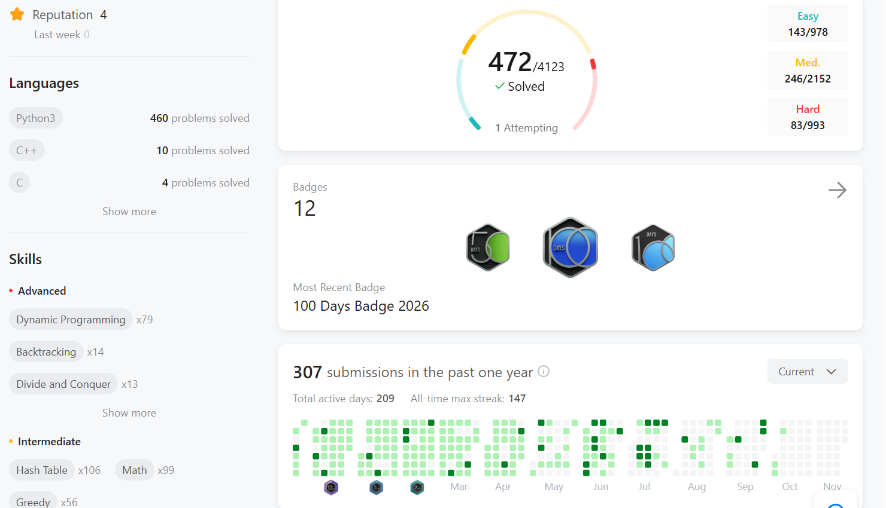

<!-- Draft only. To use, create/update the MDShish profile repository with this as README.md and include the assets folder. -->

# MD Shish

### Python Backend Engineering · AI Applications · Automation

2026 Computer Science and Engineering Graduate · Bengaluru, India

## About

I’m a 2026 Computer Science and Engineering graduate from Sambhram Institute of Technology, Bengaluru (CGPA: 7.89/10). My experience includes Python/FastAPI backend development, REST API integration, AI-enabled applications, prompt automation, and n8n workflows. Through the OSCode SaIT Community, I coordinated student contributors and helped organize technical events, workshops, hackathons, and speaker sessions.

I enjoy learning by building, working through technical problems, and collaborating with people across teams. I’m open to suitable entry-level opportunities in Python/backend engineering, AI applications and automation, application or technical support, technology operations, and program coordination.

## Areas I Work With

**Programming:** Python, C++, Java, JavaScript, C  
**Backend:** FastAPI, REST APIs, API integration, Postman  
**AI and automation:** Generative AI applications, prompt engineering, NLP, semantic retrieval, Hugging Face, n8n  
**Data and databases:** SQL fundamentals, PostgreSQL, MongoDB, Pandas, NumPy  
**Tools and foundations:** Git, GitHub, data structures and algorithms, debugging, technical communication, team coordination

## Experience and Community

- **Mindmatrix · Android Development with Generative AI · Feb–May 2026**  
  Contributed to Python/FastAPI backend development for an AI-enabled Android application and supported REST API and application-component integration. Gained introductory exposure to Google Cloud and Salesforce development environments.

- **Topper IAS · Generative AI for Media · Feb–May 2026**  
  Built prompt-automation workflows and AI-assisted content-generation pipelines for repeatable media production.

- **OSCode SaIT Community · Technical Team Member · Jun 2025–May 2026**  
  Coordinated student contributors across website development, automation, and hackathon initiatives; helped organize technical events, workshops, hackathons, and speaker sessions.

## Selected Projects

- **[AI-Powered Last-Mile Delivery Optimizer](https://github.com/MDShish/AI-Based-route-optimization)**  
  An internal logistics tool for optimizing last-mile deliveries with dynamic routing, live GPS tracking, sustainability insights, and offline capabilities — built for large-scale retailers like Walmart.

- **[HomeChef Connect](https://github.com/MDShish/HomeChef-Connect)**  
  A hyperlocal marketplace where customers can order homemade food from verified chefs, with delivery partners and administrators supporting the process.

- **[PixelGenesis · Secure Data Sharing](https://github.com/MDShish/pixelgenesis-mvp)**  
  Hackathon project exploring privacy-focused identity sharing, selective disclosure, user-controlled access, and Shamir’s Secret Sharing.

- **[ClauseCrafter AI · Intelligent Clause Retrieval](https://github.com/MDShish/ClauseCrafterAI-1-)**  
  NLP and semantic-retrieval workflows for finding relevant clauses from natural-language queries.

- **AI Virtual Dressing Room**  
  A virtual try-on project using pretrained Hugging Face models and image-segmentation workflows. Related research was published in IRJMETS, Vol. 08, Issue 03 (March 2026).

- **Meta Ad Intelligence Workflow · n8n**  
  Built an n8n workflow to automate the collection and structured analysis of Meta Ad Library information, then documented findings and limitations.

## Hackathons and Recognition

- 3rd Place · National-Level Hackathon, RR Institute
- Grand Finalist · Cardano Hackathon Asia 2025
- Grand Finalist · IBM SkillsBuild Hackathon
- Grand Finalist · IISc Cyber Crime Conclave
- Grand Finalist · PW Deep Innovation
- Related research on the AI Virtual Dressing Room project published in IRJMETS, Vol. 08, Issue 03 (March 2026)

## Problem Solving

I have solved **470+ LeetCode problems**. The profile snapshot below records **472 solved** as of November 24, 2026.

## GitHub Activity

GitHub analytics are generated by external services and reflect public repository activity.

